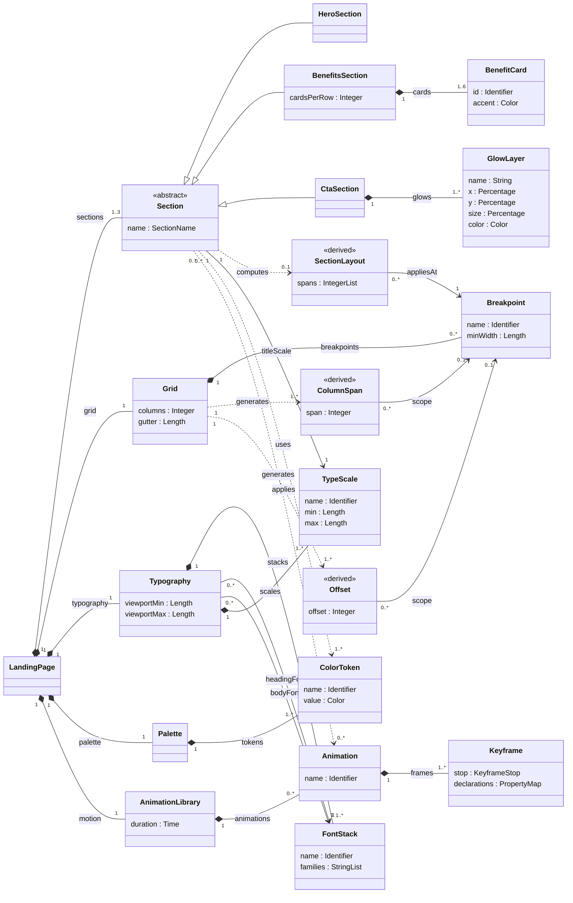

# Metamodelo del DSL SCSS-LP

Proyecto 4 de SW608 · Grupo 2

Este documento define la **sintaxis abstracta** del DSL (metaclases, metasociaciones y restricciones) y la relaciona con su **sintaxis concreta** en SCSS. La teoría está en [las bases teóricas](bases-teoricas.md).

## 1. Diagrama de clases

Las metaclases marcadas como `derived` no se escriben: el DSL las calcula a partir de las demás.



## 2. Metaclases

| Metaclase | Qué representa | Atributos |
|---|---|---|
| LandingPage | La raíz del modelo: la página que se genera. | — |
| Section (abstracta) | Un bloque de contenido de la página. | `name`: `hero`, `benefits` o `cta` |
| HeroSection | Presentación principal, con título e ilustración. | — (sus 3 anillos son fijos) |
| BenefitsSection | Características en tarjetas. | `cardsPerRow`: máximo de tarjetas por fila |
| CtaSection | Llamada a la acción final. | — |
| Grid | La cuadrícula propia. | `columns`, `gutter` |
| Breakpoint | Umbral de ancho de pantalla. | `name`, `minWidth` |
| ColumnSpan (derivada) | Utilidad que fija cuántas columnas ocupa un elemento. | `span` |
| Offset (derivada) | Utilidad que desplaza el inicio de un elemento. | `offset` |
| SectionLayout (derivada) | Reparto de columnas de una sección en un breakpoint. | `spans`: lista de anchos |
| Typography | Configuración tipográfica de la página. | `viewportMin`, `viewportMax` |
| FontStack | Pila de fuentes con nombre. | `name`, `families` |
| TypeScale | Rango de tamaño fluido de un título. | `name`, `min`, `max` |
| Palette | Conjunto de colores con nombre. | — |
| ColorToken | Un color de la paleta. | `name`, `value` |
| AnimationLibrary | Catálogo de animaciones. | `duration` |
| Animation | Una animación con nombre. | `name` |
| Keyframe | Un fotograma de una animación. | `stop`: `from`, `to` o porcentaje; `declarations`: propiedad y valor |
| BenefitCard | Variante de tarjeta; su posición en el mapa es su orden. | `id`, `accent` |
| GlowLayer | Capa de brillo del fondo de la sección final. | `name`, `x`, `y`, `size`, `color` |

`TypeScale` es la única metaclase para el tamaño de un título. El rango de viewport es común a todas las escalas y por eso pertenece a `Typography`.

## 3. Metasociaciones

| ID | Metasociación | Multiplicidad | Realización en el DSL |
|---|---|---|---|
| MA-01 | LandingPage **contiene** Section | 1 a 1..3, ordenadas y sin repetir | Lista `$section-order`, recorrida con `@each` en `_landing.scss`. |
| MA-02 | LandingPage **contiene** Grid | 1 a 1 | `@include grid.render`. |
| MA-03 | LandingPage **contiene** Typography | 1 a 1 | `$viewport-min`, `$viewport-max`, `$font-heading`, `$font-body` y los dos mapas tipográficos. |
| MA-04 | LandingPage **contiene** Palette | 1 a 1 | Mapa `$palette`. |
| MA-05 | LandingPage **contiene** AnimationLibrary | 1 a 1 | `animations.render` y `animations.library`. |
| MA-06 | Grid **contiene** Breakpoint | 1 a 0..*, en orden ascendente | Mapa `$breakpoints`. |
| MA-07 | Grid **genera** ColumnSpan | 1 a N · (1 + B) | `@for` de `grid.utilities`, repetido con `@each` por breakpoint. |
| MA-08 | Grid **genera** Offset | 1 a N · (1 + B) | El mismo mixin, con un segundo `@for`. |
| MA-09 | ColumnSpan y Offset **tienen ámbito en** Breakpoint | 0..* a 0..1 (ninguno es el ámbito base) | Prefijo del nombre, como `.col-tablet-6`, dentro de `tools.at()`. |
| MA-10 | Section **calcula** SectionLayout | 1 a 0..1 (Hero y Beneficios) | `tools.layout()` publica `--layout-tablet`. |
| MA-11 | SectionLayout **se aplica en** Breakpoint | 0..* a 1 | Parámetro de `tools.layout()`, hoy `tablet`. |
| MA-12 | Typography **contiene** FontStack | 1 a 1..* | Mapa `$font-stacks`. |
| MA-13 | Typography **elige para los títulos** FontStack | 0..* a 1 | `$font-heading` y `tools.font()`. |
| MA-14 | Typography **elige para el texto** FontStack | 0..* a 1 | `$font-body` y `tools.font()`. |
| MA-15 | Typography **contiene** TypeScale | 1 a 1..* | Mapa `$type-scale`. |
| MA-16 | Section **usa para su título** TypeScale | 1 a 1, con el mismo nombre | `tools.title-size(hero)`, `(benefits)` o `(cta)`. |
| MA-17 | Palette **contiene** ColorToken | 1 a 1..* | Entradas de `$palette`. |
| MA-18 | Section **usa** ColorToken | 0..* a 1..* | Llamadas a `tools.color()`. |
| MA-19 | AnimationLibrary **contiene** Animation | 1 a 0..* | Mapa `$animations`. |
| MA-20 | Animation **contiene** Keyframe | 1 a 1..*, ordenados | Mapa interior, recorrido con `@each` dentro de `@keyframes`. |
| MA-21 | Section **aplica** Animation | 0..* a 0..*; cada elemento, 0..1 | `$default-motion`, `$benefit-motion` y `$benefit-motion-fallback` asignan las animaciones iniciales. El HTML las aplica con `motion motion_<nombre>`. |
| MA-22 | BenefitsSection **contiene** BenefitCard | 1 a 1..6, ordenadas | Mapa `$benefit-variants`; un `@each` emite `.benefits__card_<id>`. |
| MA-23 | CtaSection **contiene** GlowLayer | 1 a 1..*, ordenadas | Mapa `$cta-glows`, convertido por `tools.glow-layers()`. |

## 4. Restricciones

La última columna indica **quién la hace cumplir**:

- **DSL:** una comprobación propia con `@error`.
- **Compilador:** Sass falla por sí mismo, a veces con un mensaje poco claro.
- **Aplicación:** la valida JavaScript (`generator.mjs` o `settings.mjs`); compilando el SCSS a mano no se detecta.
- **No se valida:** es una condición de diseño que hoy nada comprueba.

| ID | Restricción | Quién la hace cumplir |
|---|---|---|
| R-01 | Una landing tiene de 1 a 3 secciones. | Aplicación. El SCSS compila con la lista vacía. |
| R-02 | Las secciones no se repiten. | Aplicación. El SCSS compila y duplica las reglas de la sección. |
| R-03 | `Section.name` es `hero`, `benefits` o `cta`. | DSL y aplicación. |
| R-04 | `Grid.columns` es un entero de al menos 3. | DSL. El constructor solo ofrece 12 o 16. |
| R-05 | `Grid.gutter` es una longitud válida. | Aplicación en el constructor (0 a 3 rem). El SCSS no la valida. |
| R-06 | Los anchos de los breakpoints son estrictamente ascendentes. | DSL; el constructor también lo comprueba. |
| R-07 | Existe el breakpoint `tablet` si se incluye Hero o Beneficios. | DSL. |
| R-08 | No hay nombres repetidos dentro de un mapa del DSL. | Compilador (`Duplicate key.`). |
| R-09 | `0 < viewportMin < viewportMax`. | DSL, al compilar un título. |
| R-10 | En cada TypeScale, `min > 0` y `max ≥ min`. | DSL. El constructor limita además de 12 a 160 px. |
| R-11 | Cada sección incluida tiene su TypeScale. | Compilador (`Undefined operation "null <= 0px"`). |
| R-12 | `headingFont` y `bodyFont` son pilas de `$font-stacks`. | DSL y aplicación. |
| R-13 | Cada pila termina en una familia genérica. | No lo valida el SCSS. Una prueba automática lo comprueba en las pilas incluidas. |
| R-14 | La paleta define todos los colores que se usan. Reemplazarla con `with` exige el mapa completo. | DSL. |
| R-15 | `AnimationLibrary.duration` es un tiempo positivo. | Aplicación en el constructor (0 a 3000 ms). El SCSS acepta `-5ms`. |
| R-16 | `Keyframe.stop` es `from`, `to` o un porcentaje. | Compilador (`Expected "to" or "from".`). |
| R-17 | Una Animation tiene al menos un Keyframe. | No se valida. |
| R-18 | La animación por defecto o elegida para un elemento existe en la biblioteca, o es `none`. | DSL para los valores por defecto y aplicación para las elecciones en pantalla. |
| R-19 | Beneficios tiene al menos una tarjeta. | DSL, a través de `distribute()`. |
| R-20 | Beneficios tiene como máximo 6 tarjetas. | Aplicación en el constructor. El SCSS compila con 7. |
| R-21 | `cardsPerRow` es al menos 1. | Compilador (`Unsupported operation: Infinity.ceil()`). |
| R-22 | Las tarjetas de una fila no superan el número de columnas. | DSL, a través de `distribute()`. |
| R-23 | Cada fila de un SectionLayout suma `Grid.columns`. | Se cumple por construcción: lo calculan `distribute()` y `distribute-rows()`. |
| R-24 | La sección final tiene al menos un GlowLayer. | Compilador (`() isn't a valid CSS value.`). |
| R-25 | Cada GlowLayer define `x`, `y`, `size` y `color`. | No se valida. Sin `x`, compila un degradado distinto del previsto. |
| R-26 | `1 ≤ ColumnSpan.span ≤ columns` y `0 ≤ Offset.offset ≤ columns − 1`. | Se cumple por construcción: lo generan los `@for`. |
| R-27 | Al combinar offset y ancho en un elemento, su suma no supera las columnas. | No se valida: CSS crearía columnas implícitas. |

## 5. Mapeo a la sintaxis concreta

Estas son **todas las variables configurables** del DSL: las de `scss/_config.scss` y `$section-order`, declarada en `scss/_landing.scss`.

| Variable | Metaclase y atributo o asociación | Forma concreta | La consumen | ¿Se edita en pantalla? |
|---|---|---|---|---|
| `$section-order` | LandingPage → Section (MA-01) | Lista: `("hero", "cta")` | `@each` de `_landing.scss` | Sí: marcar y reordenar |
| `$grid-columns` | `Grid.columns` | Número: `12` | `grid.render`, `grid.utilities`, `sections.hero`, `sections.benefits` | Sí: 12 o 16 |
| `$gutter` | `Grid.gutter` | Longitud: `1rem` | `grid.render` | Sí: 0 a 3 rem |
| `$breakpoints` | `Breakpoint.name` y `.minWidth` | Mapa: `(tablet: 640px, desktop: 960px)` | `grid.render`, `tools.at`, `tools.layout` | Sí: tablet (480 a 900 px) y desktop (901 a 1600 px) |
| `$viewport-min` | `Typography.viewportMin` | Longitud: `360px` | `tools.fluid-type` | No |
| `$viewport-max` | `Typography.viewportMax` | Longitud: `1200px` | `tools.fluid-type` | No |
| `$type-scale` | `TypeScale.name`, `.min` y `.max` | Mapa: `(hero: (min: 44px, max: 94px), ...)` | `tools.title-size` | Sí: 12 a 160 px |
| `$font-stacks` | `FontStack.name` y `.families` | Mapa: `(serif: (Georgia, 'Times New Roman', serif), ...)` | `tools.font` | No; define las opciones |
| `$font-heading` | Typography → FontStack (MA-13) | Nombre: `slab` | `tools.font` en la marca y los títulos | Sí |
| `$font-body` | Typography → FontStack (MA-14) | Nombre: `system` | `tools.font` en `.landing` | Sí |
| `$palette` | `ColorToken.name` y `.value` | Mapa: `(background: #1c1a2c, ...)` | `tools.color` | Sí: el color; conserva la transparencia |
| `$motion-duration` | `AnimationLibrary.duration` | Tiempo: `420ms` | `animations.library` | Sí: 0 a 3000 ms |
| `$animations` | `Animation.name`; `Keyframe.stop` y `.declarations` | Mapa de mapas: `(rise: (from: (...), to: (...)))` | `animations.render`, `animations.library` | No; sí se elige cuál usa cada elemento |
| `$default-motion` | Section → Animation (MA-21) | Mapa: `(heroContent: rise, heroArt: appear, ctaLink: zoom-in)` | `readSettings()` | Se puede elegir otra animación por elemento |
| `$benefit-motion` | BenefitCard → Animation (MA-21) | Mapa: `(layout: slide-right, ...)` | `readSettings()` | Se puede elegir otra animación por tarjeta |
| `$benefit-motion-fallback` | BenefitCard → Animation (MA-21) | Nombre para tarjetas sin entrada en el mapa: `rise` | `readSettings()` | No |
| `$card-colors` | `BenefitCard.id` y acento inicial del catálogo | Mapa: `(layout: #ffc6a8, extra1: #ffe08a, ...)` | `$benefit-variants`, `readSettings()` | Se puede cambiar el color de una tarjeta agregada |
| `$benefit-variants` | `BenefitCard.id` y `.accent` (el orden es el de pantalla) | Mapa: `(layout: #ffc6a8, ...)` | `sections.benefits` | Sí: de 1 a 6 |
| `$cards-per-row` | `BenefitsSection.cardsPerRow` | Número: `3` | `sections.benefits` | No |
| `$cta-glows` | `GlowLayer.name`, `.x`, `.y`, `.size` y `.color` | Mapa de mapas: `('peach': (x: 12%, y: 0%, size: 55%, color: #ffc6a81f))` | `tools.glow-layers` | Sí: solo el color |

### Operaciones del lenguaje

| Función o mixin | Papel en el metamodelo |
|---|---|
| `tools.color($name)` | Resuelve un ColorToken y aplica R-14. |
| `tools.font($name)` | Resuelve una FontStack y aplica R-12. |
| `tools.title-size($name)` | Toma el TypeScale de un título. |
| `tools.fluid-type($min, $max)` | Traduce un rango a `clamp()`; aplica R-09 y R-10. |
| `tools.distribute($total, $parts)` | Reparte columnas sin dejar huecos. |
| `tools.distribute-rows($total, $count, $per-row)` | Calcula el SectionLayout de las tarjetas. |
| `tools.glow-layers($glows)` | Traduce los GlowLayer a capas `radial-gradient()`. |
| `tools.layout($breakpoint, $spans)` | Publica un SectionLayout; aplica R-07. |
| `tools.at($breakpoint)` | Traduce un Breakpoint a `@media (min-width: ...)`. |
| `grid.render` | Genera el Grid, sus validaciones y las utilidades de cada ámbito. |
| `grid.utilities($prefix)` | Genera los ColumnSpan y Offset de un ámbito. |
| `animations.render` | Traduce cada Animation a `@keyframes`. |
| `animations.library` | Genera `.motion_<nombre>`, solo si no se pidió reducir el movimiento. |
| `sections.hero`, `sections.benefits`, `sections.cta` | Traducen cada subclase de Section a sus reglas BEM. |

### Cómo llega el HTML a usar el grid

El reparto de una sección se decide en SCSS: `tools.layout()` lo publica como `--layout-tablet`. `src/generator.mjs` lo lee del CSS compilado y escribe las clases `.col-tablet-N` en el HTML. La asociación MA-10 une así la hoja de estilos y la página.

## 6. Ejemplo de instancia (nivel M1)

Este modelo usa 16 columnas, títulos con la pila `slab` y dos secciones:

```scss
@use "config" with (
  $grid-columns: 16,
  $font-heading: slab
);
@use "landing" with ($section-order: ("hero", "benefits"));
```

| Objeto del modelo | Resultado compilado |
|---|---|
| `Grid.columns = 16`, con 2 breakpoints | 48 clases `.col-*` y 48 `.offset-*` (16 por cada uno de los 3 ámbitos). |
| SectionLayout de Hero | 9 y 7 columnas. |
| SectionLayout de Beneficios, con 3 tarjetas | 6, 5 y 5 columnas. |
| `headingFont = slab` | Los títulos usan Rockwell o la siguiente fuente de la pila. |
| No hay CtaSection | El CSS no contiene reglas `.cta`. |
